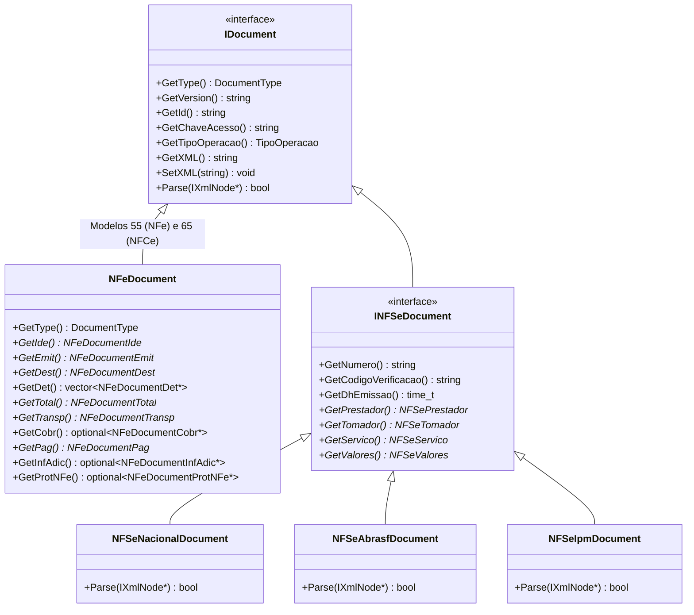

# Especificação de Requisitos de Software (ERS) — Biblioteca Zafra

**Projeto:** Zafra (`libzafra`)
**Versão do Documento:** 1.0
**Padrão C++:** C++17
**Licenciamento de Dependências:** Permissivo (MIT / BSD / Zlib)

---

## 1. Introdução e Visão Geral

### 1.1. Objetivo
A **Zafra** é uma biblioteca C++17 multiplataforma (Linux e Windows) projetada para a leitura, identificação automática, validação estrutural (XSD) e extração de dados (parsing) de documentos fiscais eletrônicos brasileiros (**NF-e**, **NFC-e** e **NFS-e** nos padrões **Nacional**, **ABRASF** e **IPM**).

### 1.2. Escopo do Sistema
O escopo funcional e técnico atual da biblioteca compreende:
1. **Abstração de Leitura XML:** Carregamento de arquivos e strings XML em memória, navegação DOM/XPath e serialização, isolando bibliotecas de terceiros (`tinyxml2` e `libxml2`) da API pública.
2. **Detecção Inteligente de Documentos (`DocumentFactory`):** Identificação automática do modelo e versão do documento fiscal a partir da estrutura raiz e namespaces do XML.
3. **Parsing Completo de NF-e (Modelo 55) e NFC-e (Modelo 65):** Mapeamento completo dos grupos do layout 4.00 da SEFAZ para classes C++, incluindo as novas tags da **Reforma Tributária (IS, IBS e CBS)**.
4. **Parsing Unificado de NFS-e (`INFSeDocument`):** Interface comum para Notas Fiscais de Serviço Eletrônicas com implementações específicas para o **Padrão Nacional (v1.00/v1.01)**, **ABRASF** e **IPM**.
5. **Validação Estrutural XSD Sob Demanda:** Validação opcional e configurável de documentos XML contra os Schemas XSD oficiais sem bloquear a leitura de documentos legados.

### 1.3. Fora de Escopo (Evolução Futura)
Os seguintes módulos **não** fazem parte do escopo obrigatório atual e ficam registrados apenas para evolução futura:
- Comunicação direta com WebServices (como `NFeDistribuicaoDFe`, Consulta Situação, Recepção de Eventos e ADN NFS-e).
- Assinatura digital XMLDSig com certificados A1/A3 e transmissão de lotes de emissão/autorização.

---

## 2. Arquitetura e Modelagem

### 2.1. Organização em Camadas
A biblioteca é dividida em módulos desacoplados sob o namespace `zafra`:
- `zafra::core`: Interfaces fundamentais (`IXmlNode`, `IXmlDocument`, `IDocument`, `INFSeDocument`), tipos enumerados (`DocumentType`, `TipoOperacao`, `RegimeTributario`) e estruturas de resultado de validação.
- `zafra::xml`: Implementação concreta de manipulação de XML (`XmlDocument`, `XmlNode`) utilizando `tinyxml2` para parsing DOM rápido e `libxml2` para validação de Schemas XSD.
- `zafra::document`: `DocumentFactory` e classes de domínio dos documentos fiscais (`NFeDocument`, `NFSeNacionalDocument`, `NFSeAbrasfDocument`, `NFSeIpmDocument`).

### 2.2. Diagrama de Classes da Hierarquia de Documentos

---

## 3. Requisitos Funcionais (RF)

### RF-01: Abstração de Leitura e Navegação XML (`zafra::xml`)
- **RF-01.1:** O sistema deve carregar documentos XML a partir de uma string em memória (`LoadFromString`) ou caminho de arquivo em disco (`LoadFromFile`).
- **RF-01.2:** O sistema deve expor a navegação pelos elementos através da interface `IXmlNode`, permitindo:
  - Obter o nome da tag (`GetName`) e o seu conteúdo textual (`GetValue`).
  - Buscar o primeiro nó filho pelo nome (`GetChild`), retornando `nullptr` caso não exista.
  - Buscar uma coleção de nós filhos com o mesmo nome (`GetChildren`).
  - Ler atributos de um elemento (`GetAttribute`), retornando `std::optional<std::string>`.
  - Exportar qualquer nó ou documento completo de volta para `std::string` (`ToString`).
- **RF-01.3:** O documento fiscal parseado deve preservar o conteúdo XML original íntegro acessível via `GetXML()` / `SetXML()`.

### RF-02: Detecção Automática de Documentos (`DocumentFactory`)
- **RF-02.1:** A classe `DocumentFactory` deve oferecer o método estático `DetectAndCreate` capaz de receber o conteúdo XML ou o nó raiz e retornar um `std::unique_ptr<core::IDocument>`.
- **RF-02.2:** Regras de identificação do documento pela tag raiz e estrutura:
  - Raiz `<nfeProc>` ou `<NFe>`: instancia `NFeDocument`.
    - Se `<ide>/<mod>` for `"55"` (ou ausente por padrão), `GetType()` deve retornar `DocumentType::NFe`.
    - Se `<ide>/<mod>` for `"65"`, `GetType()` deve retornar `DocumentType::NFCe`.
  - Raiz `<NFSe>` (com namespace do Padrão Nacional `http://www.sped.fazenda.gov.br/nfse`) ou `<DPS>`: instancia `NFSeNacionalDocument` (`DocumentType::NFSeNacional`).
  - Raiz `<CompNfse>`, `<ConsultarNfseResposta>` ou `<ListaNfse>` (padrão ABRASF): instancia `NFSeAbrasfDocument` (`DocumentType::NFSeAbrasf`).
  - Raiz `<nfse>` ou estrutura característica do provedor IPM: instancia `NFSeIpmDocument` (`DocumentType::NFSeIpm`).
  - Caso o XML seja inválido ou não corresponda a nenhum modelo suportado, deve retornar `nullptr` sem lançar exceções.

### RF-03: Validação Estrutural contra Schemas XSD
- **RF-03.1:** A biblioteca deve permitir validar um XML contra os arquivos `.xsd` oficiais (localizados em `schemas/nfe/v400` e `schemas/nfse/nacional/v100` e `v101`) utilizando a `libxml2`.
- **RF-03.2:** A validação XSD deve ser **sob demanda / configurável** (através de um validador dedicado ou parâmetro opcional), retornando um resultado estruturado (booleano de sucesso + lista de mensagens de erro com linha e coluna).
- **RF-03.3:** Divergências estritas de XSD comuns em XMLs legados ou ERPs de terceiros (como quebras de linha em `<xProd>` ou ausência de tags não vitais) **não devem impedir** o funcionamento do método `Parse()` quando a validação estrita não for exigida pelo chamador.

### RF-04: Leitura e Parsing de NF-e e NFC-e (`NFeDocument`)
A classe `NFeDocument` deve extrair os dados tanto de XMLs somente da nota (`<NFe>`) quanto de XMLs processados com protocolo (`<nfeProc>`):

- **RF-04.1: Metadados de `infNFe`:**
  - `versao` (ex: `"4.00"`), `Id` (ex: `"NFe4226..."`) e `ChaveAcesso` (44 dígitos numéricos extraídos removendo o prefixo `"NFe"`).
- **RF-04.2: Grupo Identificação (`ide` - `NFeDocumentIde`):**
  - `cUF`, `cNF`, `natOp`, `mod` (`55` ou `65`), `serie`, `nNF`, `dhEmi` (convertido para `time_t`), `dhSaiEnt` (opcional, convertido para `time_t`), `tpNF` (mapeado também para `TipoOperacao::Entrada` ou `TipoOperacao::Saida`), `idDest`, `cMunFG`, `tpImp`, `tpEmis`, `cDV`, `tpAmb`, `finNFe`, `indFinal`, `indPres`, `indIntermed`, `procEmi`, `verProc` e notas referenciadas (`NFref`).
- **RF-04.3: Grupo Emitente (`emit` - `NFeDocumentEmit` e `enderEmit` - `NFeDocumentEndereco`):**
  - `CNPJ` ou `CPF`, `xNome` (Razão Social), `xFant` (Nome Fantasia, assumindo `xNome` caso omitido), `IE`, `IEST` (opcional), `IM` (opcional), `CNAE` (opcional), `CRT` (mapeado para `RegimeTributario`).
  - Endereço completo (`xLgr`, `nro`, `xCpl` opcional, `xBairro`, `cMun`, `xMun`, `UF`, `CEP`, `cPais` opcional, `xPais`, `fone` opcional).
- **RF-04.4: Grupo Destinatário (`dest` - `NFeDocumentDest` e `enderDest` - `NFeDocumentEndereco`):**
  - Opcional em NFC-e; obrigatório em NF-e.
  - `CNPJ`, `CPF` ou `idEstrangeiro`, `xNome`, `indIEDest`, `IE` (opcional), `ISUF` (opcional), `IM` (opcional), `email` (opcional) e endereço `enderDest` (opcional em NFC-e).
- **RF-04.5: Grupo Detalhamento de Produtos e Serviços (`det` - `NFeDocumentDet`):**
  - Atributo `nItem` (inteiro de 1 a 990) e informações adicionais do item `infAdProd` (opcional).
  - **Subgrupo Produto (`prod` - `NFeDocumentDetProd`):** `cProd`, `cEAN`, `xProd` (com quebras de linha removidas), `NCM`, `CEST` (opcional), `CFOP`, `uCom`, `qCom`, `vUnCom`, `vProd`, `cEANTrib`, `uTrib`, `qTrib`, `vUnTrib`, `vFrete` (opcional), `vSeg` (opcional), `vDesc` (opcional), `vOutro` (opcional), `indTot`, `xPed` / `nItemPed` (opcionais).
- **RF-04.6: Subgrupo Tributos do Item (`imposto` - `NFeDocumentDetImposto`):**
  - **ICMS (`NFeDocumentDetImpostoICMS`):** Suporte aos grupos de Regime Normal (`ICMS00`, `ICMS10`, `ICMS20`, `ICMS30`, `ICMS40`, `ICMS51`, `ICMS60`, `ICMS70`, `ICMS90`, `ICMSPart`, `ICMSST`) e Simples Nacional (`ICMSSN101`, `ICMSSN102`, `ICMSSN201`, `ICMSSN202`, `ICMSSN500`, `ICMSSN900`), extraindo `orig`, `CST` ou `CSOSN`, `modBC`, `vBC`, `pRedBC`, `pICMS`, `vICMS`, `vBCST`, `pMVAST`, `pICMSST`, `vICMSST`, `vICMSDeson`, `motDesICMS`, `pBCOp`, `UFST`, `pCredSN`, `vCredICMSSN` e campos de FCP (`vBCFCP`, `pFCP`, `vFCP`, `vBCFCPST`, `pFCPST`, `vFCPST`).
  - **IPI (`NFeDocumentDetImpostoIPI`):** `cEnq`, `CNPJProd`, `cSelo`, `qSelo` e subgrupos `IPITrib` / `IPINT` (`CST`, `vBC`, `pIPI`, `qUnid`, `vUnid`, `vIPI`).
  - **II (`NFeDocumentDetImpostoII`):** `vBC`, `vDespAdu`, `vII`, `vIOF`.
  - **PIS e PISST (`NFeDocumentDetImpostoPIS`, `NFeDocumentDetImpostoPISST`):** Subgrupos `PISAliq`, `PISQtde`, `PISNT`, `PISOutr` (`CST`, `vBC`, `pPIS`, `qBCProd`, `vAliqProd`, `vPIS`).
  - **COFINS e COFINSST (`NFeDocumentDetImpostoCOFINS`, `NFeDocumentDetImpostoCOFINSST`):** Subgrupos `COFINSAliq`, `COFINSQtde`, `COFINSNT`, `COFINSOutr` (`CST`, `vBC`, `pCOFINS`, `qBCProd`, `vAliqProd`, `vCOFINS`).
  - **ICMSUFDest (`NFeDocumentDetImpostoICMSUFDest`):** Partilha de ICMS interestadual para consumidor final (`vBCUFDest`, `vBCFCPUFDest`, `pFCPUFDest`, `pICMSUFDest`, `pICMSInter`, `pICMSInterPart`, `vFCPUFDest`, `vICMSUFDest`, `vICMSUFRemet`).
  - **Reforma Tributária — Imposto Seletivo (`IS` - `NFeDocumentDetImpostoIS`):** `CSTIS`, `cClassTribIS`, `vBCIS`, `pIS`, `pISEspec`, `uTrib`, `qTrib`, `vIS`.
  - **Reforma Tributária — IBS e CBS (`IBSCBS` - `NFeDocumentDetImpostoIBSCBS`):** `CST`, `cClassTrib`, base de cálculo `vBC`, grupo `gIBSUF` (`pIBSUF`, `vIBSUF`), grupo `gIBSMun` (`pIBSMun`, `vIBSMun`), `gCBS` (`pCBS`, `vCBS`), além de grupos de diferimento, devolução de tributos, redução de alíquota e regime regular/crédito presumido conforme Notas Técnicas da Reforma Tributária.
- **RF-04.7: Grupo Totais da NF-e (`total` - `NFeDocumentTotal`):**
  - **Subgrupo `ICMSTot`:** `vBC`, `vICMS`, `vICMSDeson`, `vFCPUFDest`, `vICMSUFDest`, `vICMSUFRemet`, `vFCP`, `vBCST`, `vST`, `vFCPST`, `vFCPSTRet`, `vProd`, `vFrete`, `vSeg`, `vDesc`, `vII`, `vIPI`, `vIPIDevol`, `vPIS`, `vCOFINS`, `vOutro`, `vNF`, `vTotTrib`.
  - **Subgrupos da Reforma Tributária (`ISTot` e `IBSCBSTot`):** Totais do Imposto Seletivo (`vIS`), total da BC do IBS/CBS (`vBCIBSCBS`), totais de IBS Estadual/Municipal e total da CBS (`vCBS`).
- **RF-04.8: Grupo Transporte (`transp` - `NFeDocumentTransp`):**
  - `modFrete`, dados da transportadora `transporta` (`CNPJ`/`CPF`, `xNome`, `IE`, `xEnder`, `xMun`, `UF`), veículo (`veicTransp`: `placa`, `UF`, `RNTC`) e lista de volumes `vol` (`qVol`, `esp`, `marca`, `nVol`, `pesoL`, `pesoB`).
- **RF-04.9: Grupo Cobrança (`cobr` - `NFeDocumentCobr`):**
  - Fatura `fat` (`nFat`, `vOrig`, `vDesc`, `vLiq`) e lista de duplicatas `dup` (`nDup`, `dVenc`, `vDup`).
- **RF-04.10: Grupo Pagamento (`pag` - `NFeDocumentPag`):**
  - Lista de detalhamento `detPag` (`indPag`, `tPag`, `xPag`, `vPag`, dados de cartão `card`) e troco (`vTroco`).
- **RF-04.11: Grupos Informações Adicionais (`infAdic`), Responsável Técnico (`infRespTec`) e Protocolo (`protNFe`):**
  - `infAdFisco` e `infCpl` em `infAdic`.
  - `CNPJ`, `xContato`, `email`, `fone` em `infRespTec`.
  - Dados de autorização em `protNFe/infProt`: `tpAmb`, `verAplic`, `chNFe`, `dhRecbto`, `nProt`, `digVal`, `cStat` e `xMotivo`.

### RF-05: Leitura e Parsing de NFS-e (`INFSeDocument` e Implementações)
- **RF-05.1: Interface Comum `INFSeDocument`:**
  - Deve herdar de `core::IDocument` e fornecer acesso padronizado independente da prefeitura/provedor para:
    - **Identificação:** Número da NFS-e, Código de Verificação / Chave de Acesso, Data/Hora de Emissão (`time_t`), Competência, Natureza da Operação / Código de Tributação.
    - **Prestador (`NFSePrestador`):** CNPJ/CPF, Inscrição Municipal, Razão Social, Nome Fantasia, Endereço e Contato.
    - **Tomador (`NFSeTomador`):** CNPJ/CPF, Inscrição Municipal, Razão Social/Nome, Endereço e E-mail.
    - **Serviço (`NFSeServico`):** Item da Lista de Serviços (LC 116), Código CNAE, Código de Tributação Municipal/Nacional (`cTribNac` / `cTribMun`), Discriminação do Serviço, Município de Incidência (`cMunIncidencia`).
    - **Valores e Tributos (`NFSeValores`):** Valor dos Serviços, Deduções, Descontos (incondicionado/condicionado), Base de Cálculo, Alíquota de ISS, Valor do ISS, Indicador de ISS Retido, Retenções Federais (`vPis`, `vCofins`, `vInss`, `vIr`, `vCsll`), Valor Líquido da NFS-e e campos de **IBS/CBS** da Reforma Tributária.
- **RF-05.2: Implementações Concretas:**
  - `NFSeNacionalDocument`: Mapeia o layout do Sistema Nacional NFS-e (v1.00 e v1.01, tags `<NFSe>/<infNFSe>` e `<DPS>`).
  - `NFSeAbrasfDocument`: Mapeia o layout ABRASF (v1.00 / v2.01 / v2.04, tags `<CompNfse>/<Nfse>/<InfNfse>`).
  - `NFSeIpmDocument`: Mapeia o layout próprio utilizado pelo sistema IPM Atende.Net (`<nfse>`).

### RF-06: Sanitização, Conversão e Normalização de Dados
- **RF-06.1: Remoção de Quebras de Linha em `xProd`:**
  - Antes de armazenar a descrição do produto (`m_xProd`), o parser deve remover quebras de linha (`\r` e `\n`), substituindo-as por espaço simples quando separarem palavras, sem gerar espaços duplicados nem deixar espaços sobrando nas extremidades.
- **RF-06.2: Conversão de Datas e Timestamps (`ParseIso8601`):**
  - Campos de data/hora no padrão SEFAZ (`AAAA-MM-DDThh:mm:ssTZD`, ex: `2026-07-30T17:42:23-03:00`) e datas simples (`AAAA-MM-DD`) devem ser convertidos de forma independente do fuso horário da máquina hospedeira para Unix Timestamp UTC (`time_t`).
- **RF-06.3: Conversão de Valores Decimais (`ParseDouble`) e Inteiros:**
  - Todas as conversões numéricas de strings do XML devem utilizar `std::locale::classic()` (separador decimal ponto `.`), garantindo que configurações regionais do sistema operacional (como `pt_BR.UTF-8` que usa vírgula `,`) nunca corrompam valores monetários ou quantidades.

---

## 4. Requisitos Não-Funcionais (RNF)

### RNF-01: Resiliência e Política *No-Throw* / *Null-Safety*
- O parser **nunca** deve causar *Segmentation Fault* (acesso a ponteiro nulo ou não inicializado) caso uma tag ou atributo esperado não esteja presente no XML.
- Funções de conversão numérica, de datas ou de enumeradores (`ParseTipoOperacao`, `ParseRegimeTributario`, etc.) não devem propagar exceções não tratadas (`std::invalid_argument`, `std::out_of_range`, `std::bad_optional_access`) para fora do método `Parse()`. Valores não reconhecidos em enumeradores devem resultar em `Unknown` e números vazios/inválidos devem assumir valor padrão seguro (`0` ou `0.0`).

### RNF-02: Gerenciamento Seguro de Memória (RAII)
- Todos os ponteiros membros de classes de documento devem ser inicializados explicitamente com `nullptr` (ou gerenciados via `std::unique_ptr` / objetos por valor / `std::optional`) e liberados integralmente nos destrutores das suas respectivas classes proprietárias, garantindo **zero vazamentos de memória (*memory leaks*)**.
- Objetos `XmlNode` não devem sobreviver ao ciclo de vida do `XmlDocument` que os originou; a extração dos dados para os membros das classes `IDocument` deve ocorrer integralmente durante a execução do `Parse()`.

### RNF-03: Ordenação Determinística de Itens (`nItem`)
- A coleção de itens de documento fiscal (`NFeDocument::GetDet()`) deve manter os itens ordenados de forma determinística pelo número sequencial do item no XML (`nItem` crescente: 1, 2, 3...), e nunca pelo endereço de memória do ponteiro.

### RNF-04: Padronização de API e Nomenclatura
- Todos os métodos públicos das interfaces e classes de domínio devem seguir a convenção **PascalCase** (`GetVersion()`, `GetId()`, `GetXML()`, `GetChaveAcesso()`, `GetTipoOperacao()`), mantendo aliases temporários quando necessário para retrocompatibilidade.
- Campos e subgrupos que são opcionais segundo o schema da SEFAZ/NFS-e devem utilizar `std::optional<T>` (para tipos de valor) ou ponteiros devidamente verificáveis contra `nullptr` (para objetos compostos).

### RNF-05: Portabilidade, Build System e Empacotamento
- O código deve compilar sem erros em **C++17** (`CMAKE_CXX_STANDARD 17`) tanto em **Linux** (GCC / Clang, gerando `.so` / `.a`) quanto em **Windows** (MSVC / MinGW, gerando `.dll` / `.lib`).
- O `CMakeLists.txt` deve suportar exportação de alvos CMake (`zafraConfig.cmake`) e instalação padrão via `GNUInstallDirs`.

### RNF-06: Testabilidade e Qualidade (TDD & Integração)
- Todo requisito funcional de leitura e sanitização deve possuir cobertura de testes automatizados utilizando **Google Test (GTest)** via `ctest`.
- A suíte de integração (`NFeIntegrationTest`) deve suportar testes parametrizados (`TEST_P`) que varrem automaticamente o diretório `tests/data/` validando o carregamento e parsing de arquivos XML reais sem falhar caso o diretório esteja vazio (`GTEST_ALLOW_UNINSTANTIATED_PARAMETERIZED_TEST`).

---

## 5. Matriz de Rastreabilidade e Status Atual

| ID | Requisito | Componente Principal | Status Atual |
| :--- | :--- | :--- | :--- |
| **RF-01** | Abstração de Leitura e Navegação XML (`tinyxml2`) | `zafra::xml::XmlDocument`, `XmlNode` | Implementado |
| **RF-02** | Detecção de NF-e/nfeProc na `DocumentFactory` | `zafra::document::DocumentFactory` | Implementado (NFe) / Parcial (NFCe e NFSe) |
| **RF-03** | Validação Estrutural XSD sob demanda (`libxml2`) | `zafra::xml` / `schemas/` | Schemas e `libxml2` integrados; API de validação a implementar |
| **RF-04.1 a 04.6** | Parsing NF-e: `ide`, `emit`, `dest`, `det`, `prod`, `imposto` | `zafra::document::NFeDocument` | Implementado (pendente `IBSCBS` e CSOSNs/CSTs adicionais) |
| **RF-04.7 a 04.11** | Parsing NF-e: `total`, `transp`, `cobr`, `pag`, `infAdic`, `protNFe` | `zafra::document::NFeDocument` | Planejado |
| **RF-05** | Interface `INFSeDocument` e Parsers Nacional, ABRASF e IPM | `zafra::document::NFSe*Document` | Stub criado (`NFSeNacionalDocument`); demais planejados |
| **RF-06** | Sanitização (`xProd`), Datas ISO 8601 (`time_t`) e Decimais | `nfe_document.cpp` (`ParseIso8601`, `RemoveLineBreaks`, `ParseDouble`) | Implementado |
| **RNF-01 a 06** | Resiliência, RAII, Ordenação `nItem`, Padronização e Testes GTest | Global (`include/zafra`, `src/`, `tests/`) | Em consolidação |
